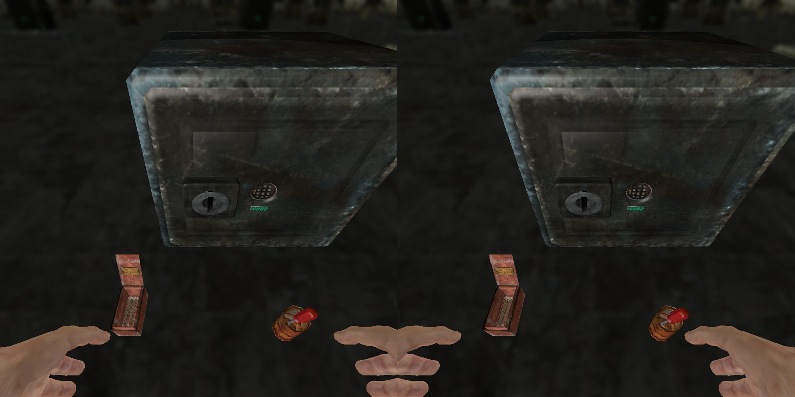
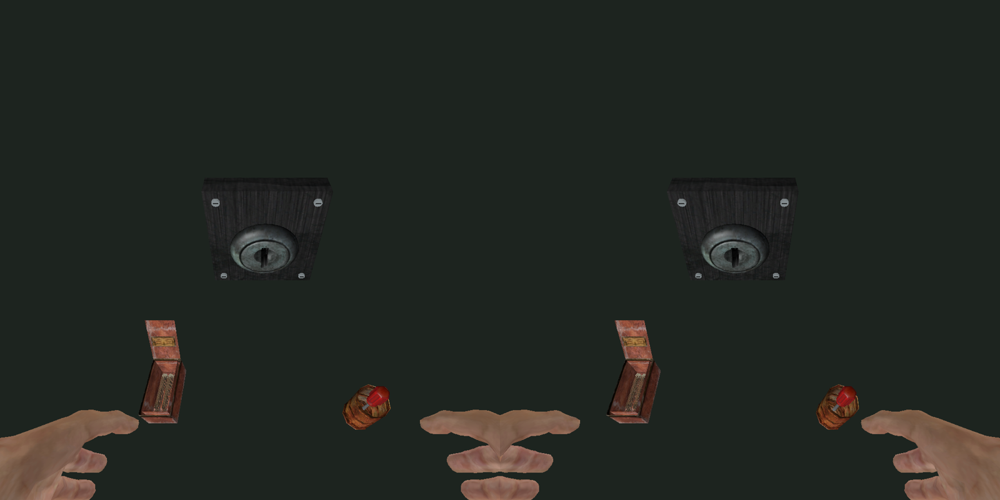
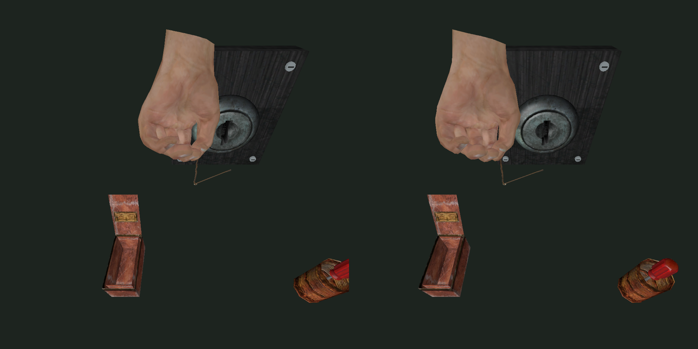
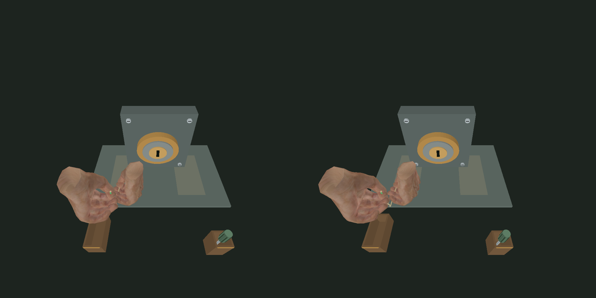
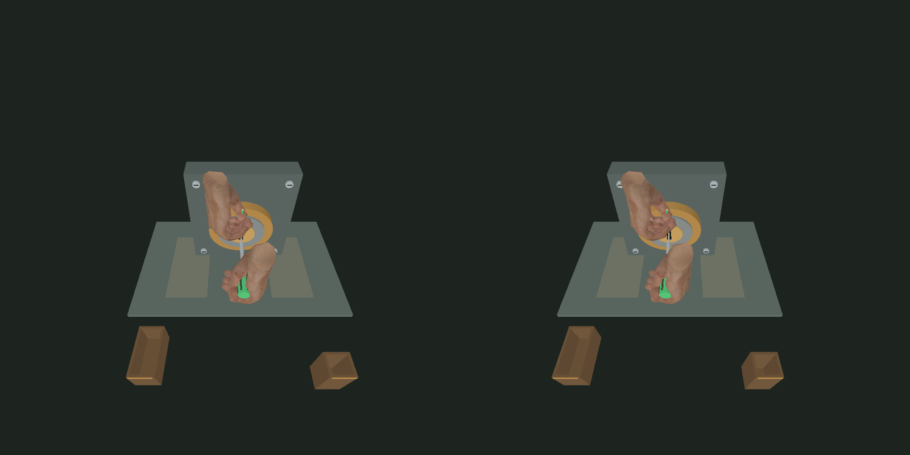
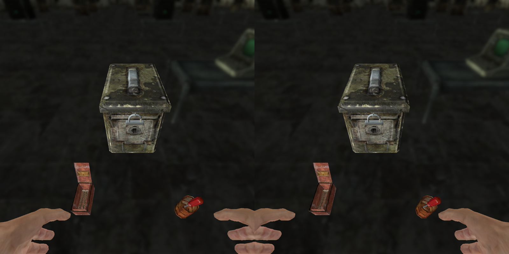

# TTWVR Physical Lockpicking

Experimental two-hand lockpicking for Tale of Two Realities 1.1.6 and Fallout New Vegas 1.4.0.525. A floating 3D lock opens at lower-chest height in front of a dimmed, blurred stereo view of the game world. Locally prepared Fallout props provide the worn lock, red-handled screwdriver, bobby pin, open Bobby Pins box and rusty tin-can holder. Draw a folded pin from the left holder and a screwdriver from the right, bend the pin with both hands, insert both tools centrally, then search and turn using the native game's resistance and haptics. Either hand can hold either tool.

This experimental addon is developed and tested in a separate profile with copied saves. Use the same isolation when trying it. Supported targets display their model around the working lock in the reachable workspace; the surrounding game world remains visible behind the tools. This is a presentation copy, not an in-world relocation.


## Project status

This repository contains the **version 24** addon source, asset-preparation tools, capture tools and optional test-stage generator. Development has been validated with TTWVR 1.1.6 and Fallout New Vegas 1.4.0.525 through Linux/Proton. Native Windows builds and recording still need runtime validation. See the [recorded checks and limitations](docs/VALIDATION.md).



## Additional information: the void and the game background

The original dark “void” was an opaque stereo OpenXR layer. Each eye's image was cleared to a near-black colour, then the lock, tools and hands were rendered over it. That layer covered the normal game view. The player remained at the original location; the native lockpicking menu controlled the paused game underneath.

The current workspace uses the same presentation. It copies each eye's game image on the GPU while the application still owns it, dims and blurs that copy, then draws the sharp interactive objects in front. Displaying a safe or door around the lock uses a separate copy of that model in the reachable workspace.

Set `UseGameBackground=0` in `TTWVRPhysicalLockpicking.ini` to restore the dark background for the next lock attempt. The dark background also provides a fallback when a valid game image is unavailable. See [how the workspace is rendered](docs/WORKSPACE-BACKGROUND.md) for the rendering steps and settings.

## Test galleries

The optional [private test-stage generator](tools/test_stage/README.md) provides labelled object rows at all five difficulties and a terminal for skill, perks, resets and supplies. It is separate from the addon DLL and intended for a copied-save test profile.

## Controls

1. Activate a locked object normally. The upright workspace appears 42 cm forward and 42 cm below your initial eye position. Looking down does not tilt it.
2. Release both grab buttons, then reach to a holder and press side grip or trigger. Pins lie loose in the left box, the screwdriver starts on the right. Either hand can draw either tool. Move an empty hand through the pile to nudge the pins with finger/palm contact. Release a pin above the box to let it fall back in; it rejoins the stored pile once settled. The screwdriver falls freely into the can and leans against its rim; dropping near it no longer snaps the tool to a fixed pose. It returns to the can only if lost.
3. Hold the pin at the thumb/index pinch. With the other hand, grip near its free end and move that hand to bend it. You can under-bend, over-bend, change the bend's plane, stop partway, regrip and correct it. Moving both hands together leaves its shape unchanged. Aim for an L shape; a short pulse marks entry into the recommended bend range.
4. Release the assisting hand. A still-folded pin needs opening first (at least about 36°). Other bends, including the reported 65° bend, can engage. An approximately 90–105° bend is easiest to fit. Poor bends and tilted entry can restrict movement against the housing. The game uses the visible pin angle; there is no separate sensitivity multiplier changing the native angle behind the visible tool. Preparation does not change the hidden solution or character skill.
5. Place the straight tip in the visible slot: the pin engages in its actual position and orientation, without jumping onto the centre axis or pushing itself deeper. A near miss stays outside. It can approach inclined and at any wrist roll. It works shallowly; pushing deeper is optional. Shape and alignment determine where the pin contacts the housing. The pin swivels around its contact point as you move your hand; housing contact limits its tilt and depth. The screwdriver retains its approximately 1.8 cm insertion push. Each engaged tool gives a short vibration.
6. Move the pin hand around the keyhole in an arc to search. Its actual angle relative to the cylinder controls the native minigame. Ease off screwdriver tension to adjust it: under tension, its search pose is held while the whole pin and contact point turn with the cylinder. Hand movement against that resistance cannot secretly change the search angle. Releasing tension keeps the chosen position without a jump. Twist the screwdriver clockwise around its own handle: 40° wrist travel requests the full native 90° turn. Native resistance remains the limit.
7. Release an inserted tool to leave it supported. Releasing the screwdriver removes torque immediately. Regrip at a comfortable wrist angle and continue. Pull the pin back out; shallow insertions need only a short pull. The screwdriver still withdraws after about 5.5 cm. If a bad insertion wedges, pull the hand deliberately forward into clear space and hold briefly. Recovery covers both an engaged pin and a pin caught by housing collision after withdrawal; it keeps the same pin in your hand. It cannot immediately catch again until the tip clears the face.
8. Releasing a loose pin away from its holder lets it fall. At a real lock, one pin leaves your inventory and becomes an ordinary pickup on the floor beside the object, on your side. Exit the workspace to pick it up normally. A fresh folded pin appears only if stock remains; your last pin leaves the holder empty. The screwdriver is reusable and returns if lost. At a practice lock without a target, or if inventory integration is unavailable, lost tools return to their holders instead. Consecutive world drops use separate landing positions.
9. When the native lock resists, the pin visibly trembles. This animation never changes the requested pick angle or difficulty and is identical in time for both eyes. Resistance retains the strong contact pulse and pause, followed by faster pulses as strain rises. Break feedback and native sound remain. Breaking a pin still consumes it through the game; its replacement starts folded.
10. B/back exits. **F8** restores the original minigame for the current attempt. Reopening starts the addon again.

Each tool has one primary owner; the other hand may assist with bending. Entering range with a button already held does not auto-grab. Grip tolerances are 4 cm around the pin handle, 4.5 cm around the screwdriver and 5 cm around the free pin end so controller shells need not overlap. Holders stay fixed in front of your waist for the attempt; they do not follow head yaw or modify TTWVR's body holsters.

The pin box shows your inventory through individual pins, with no text counter. It displays up to 18; additional stock stays in inventory and refills the visible supply as needed. The held/inserted pin is excluded from the pile. You can select a particular visible pin, return it with gravity, or drop it outside to create a native floor pickup. Stored pins have simplified wire collisions, gravity and sleeping when settled. Swept finger/palm proxies let either empty hand stir them; this uses controller poses, not optical finger tracking. Hands holding a tool or assisting a bend do not stir the pile. Tracking jumps are ignored. The box stays fixed and stored contents are contained; moving/tipping it and unrestricted pile spills are later work. Bent shapes remain on stored physical pins during this attempt, but are not saved into the ordinary inventory stack.

Bending is a continuous, reversible hinge model with a variable bend plane, not a full deformable-metal solver. Shape is retained while handling/storing the same pin during an attempt. Inventory pins remain the game's ordinary stackable items: individual bend shapes are not saved on world pickups. New attempts and replacement pins start folded. `RequirePinPreparation=0` supplies ready L-shaped pins for minigame-only testing.

There is no tray or invisible floor beneath the lock. Both held and falling tools collide with the selected housing, while the central keyway remains open. The default lock is circular; the supported ammo box uses a padlock, and the standard safe uses a rounded-square frame. A brief contact tap marks a held tool hitting the housing. Tool motion and gravity are simulated locally; arbitrary game-world meshes, your body and the other tool are not collision targets. An engaged pin retains its real entry point and approach angle. Housing contact bounds subsequent movement. Tracking/focus loss and recentering clear grips and restore the workspace. Headset reach and visual hand alignment still need physical confirmation.

### Placement and comfort settings

`TTWVRPhysicalLockpicking.ini` lives beside the DLL and reloads for each new attempt. Missing/invalid values use bounded defaults.

| Setting | Default | Meaning |
| --- | --- | --- |
| `RequirePinPreparation` | 1 | Start with folded pins; 0 starts prepared |
| `UseGameProps` | 1 | Use locally prepared textured Fallout props; 0 keeps simple geometry. Missing/invalid assets also use simple geometry |
| `UseToolHolders` | 1 | Show the physical pin box and driver holder; 0 uses hidden single-tool anchors |
| `DropPinsToWorld` | 1 | Inventory-backed floor pickups at real lock targets |
| `LockDistanceMeters` | 0.42 | Horizontal distance from your opening eye pose |
| `LockBelowEyesMeters` | 0.42 | Vertical distance below your eyes |
| `PinHolderSideMeters` / `DriverHolderSideMeters` | −0.22 / 0.22 | Left/right offset from the opening eye pose |
| `PinHolderBelowEyesMeters` / `DriverHolderBelowEyesMeters` | 0.60 / 0.60 | Holder grasp height below the eyes |
| `PinHolderForwardMeters` / `DriverHolderForwardMeters` | 0.16 / 0.16 | Holder grasp distance forward from the eyes |
| `FullTurnWristDegrees` | 40 | Wrist travel requesting the native 90° cylinder turn |
| `HandConstraintMeters` | 0.035 | Maximum visual hand translation to a constrained tool |
| `HandConstraintDegrees` | 20 | Maximum visual tool-hand rotation correction; pin presentation is capped at 20° |
| `InsertRadiusMeters` | 0.028 | Screwdriver approach tolerance; the pin must reach the actual slot |
| `InsertionTravelMeters` | 0.018 | Screwdriver insertion travel; pin engagement does not require a stroke |
| `WithdrawTravelMeters` | 0.055 | Pull distance to extract a seated tool |

`PickSweepMeters` and `PickWristHalfRangeDegrees` are obsolete and ignored. Pin searching follows an arc around the keyhole. Holders use the opening head frame and remain fixed for the attempt.

## Architecture

One 32-bit DLL exposes an xNVSE plugin and an OpenXR API layer. Thirteen game call sites are signature-checked together before patching: the controller-axis reads for pick angle and torque, the native cylinder-angle limit, and ten input-mode checks used only by the lock menu. While the physical menu owns input, those mode checks route both keyboard/mouse and gamepad configurations through the verified axis hooks; the global controller setting is unchanged. Pick angle is converted to the actual UI track width. The additional clamp can only reduce the native permitted cylinder rotation to the held wrist angle; it cannot exceed native resistance. Native damage and success checks still run afterwards. No held screwdriver and no wrist tension means no positive cylinder rotation. Stale input restores the original axis reads, mode checks and angle limit.

`ToolGeometry.h` shares rendered/interactive tool geometry. `PinBox.h` simulates the stored pile with wire-segment contacts, a bounded fixed container, individual selection and sleep. Returning/drawing pins changes no inventory count; only the existing native drop/break paths spend a pin. `DriverCan.h` uses rigid-body contact impulses against the open can, including angular inertia, bottom and rim friction. `Collision.h` sweeps sampled tool volumes against the housing and keyway, including intermediate rotation, and slides on contact. `Physical.h` owns tool contact, exclusive ownership, free bending, holder return, insertion, regripping, gravity and drop requests. Rendered and interactive geometry share the same tip-relative shape. The engaged pin keeps its collision-resolved entry pose and pivots about its actual contact point, with optional depth adjustment. The collision keyway uses a simple rectangular bore; the textured original lock retains its decorative recessed keyhole profile. The working tips and cylinder axis align, but decorative recesses and the raised carton lid are not additional collision surfaces; no broad magnetic capture or canonical seating pose is applied. The native search angle is derived from the constrained pin pose in the cylinder frame. It never follows an unconstrained hand independently of the rendered tool. The supported pose and entry point follow cylinder rotation; tension holds the search pose, and unloading rebases hand control without a jump. A deliberate clear-space pull recovers an engaged or withdrawn wedge. The quality value is diagnostic and does not multiply the native angle. Resistance trembling affects only the copied render pose. The screwdriver pivots at the keyhole and permits a bounded downward/sideways tilt. Its blade is narrow enough to fit beside the pin through the native cylinder's rotation.

Driver control uses a palm grip frame fitted from the installed curled hand mesh. Pin control uses the fitted thumb/index midpoint and tracked aim orientation. A held hand uses the complete curled/pinch pose. Once seated, visual hands may move up to 3.5 cm and the driver hand may rotate up to 20° to maintain contact. The primary pin hand also receives a bounded precision-grip presentation while held: the palm tilts back by up to 20° and the pads touch 1 cm nearer the held leg’s end, leaving more wire visible. The same translation limit applies. Input always uses the unmodified tracked poses. The assisting hand receives the same bounded translation toward the free pin end. These are bounded visual corrections, not controller tracking changes.

`Inventory.cpp` uses the public [xNVSE scripting interface](https://github.com/xNVSE/NVSE/blob/master/nvse/nvse/PluginAPI.h) on the game thread. JIP’s [`PlaceAtCell`](https://github.com/jazzisparis/JIP-LN-NVSE/blob/main/functions_jip/jip_fn_misc_ref.h) creates each native pickup directly at its final coordinates, avoiding relocation before model/physics initialization. Landing positions are spaced near the player’s side of the target. It removes one inventory pin only after creation succeeds, verifies the count, and removes the pickup if the count did not fall by one. An acknowledged drop can supply a new visual pin only from remaining stock. A new pin restores the native initial condition captured for this attempt; no solution, difficulty or success state is changed. Stale attempts, fallback, changed targets and unavailable scripting cancel the transaction. No inventory mutation runs on the OpenXR thread. World pickups use normal engine save persistence and activation. No new ESP is required. Practice menus without a target bypass world dropping.

The API layer claims trigger and squeeze inputs at the highest action-set priority while the physical menu is active. While the workspace is presented, application float, boolean and stick input queries are neutralized, except bindings for Back/B/menu. This prevents a grab from also activating TTWVR’s native minigame controls. Input routing is fixed for each sync interval and returns to the application on fallback or menu exit. The priority behavior follows the [OpenXR action-set specification](https://registry.khronos.org/OpenXR/specs/1.1/man/html/XrActionSetCreateInfo.html).

The API layer adds its own actions and two D3D11 swapchains. It acquires, waits, renders and releases only those images. It retains the application's submitted layers and appends an opaque stereo workspace. A deferred D3D11 context and state-preserving command-list execution keep the game context intact. Game meshes and textures are separate, locally generated dependencies; no such assets or shader binaries are bundled in the addon release.

Completing preparation triggers one 45 ms pulse at amplitude 0.55 in each participating hand. Seating triggers a one-shot 35 ms pulse at amplitude 0.65 on that tool’s hand. Resistance and break cues take priority. The native jam state triggers a 70 ms contact tap at maximum amplitude, followed by at least 90 ms of silence before the warning rhythm begins. Extra wrist twist beyond the stopped cylinder is an angular pressure proxy: zero to 20 degrees changes the warning interval from 220 to 60 ms. Pick damage can also accelerate it. Warning pulses last 40 ms at amplitude 0.85–1.00; normal turning remains at 0.45 for 28 ms. A contact latch tolerates small wrist/state fluctuations so they cannot repeatedly retrigger or truncate the tap; backing off clearly or releasing rearms it. These are normalized OpenXR amplitude requests and pulse repetition intervals, not measured force or a requested motor frequency. The runtime chooses its vibration carrier frequency. No hidden solution is read. Original application vibration/stop calls are suppressed while the physical menu owns input so they cannot overwrite these cues. Addon pulses stop on release, tracking or focus loss, recentering, fallback, menu exit and renderer failure. The normal game audio remains audible.

The native minigame remains active behind the workspace. Its models and lock references remain native. Presentation does not force an unlock; the separate inventory transaction handles deliberate drops and replacement condition. Unsupported runtime signatures, disabled settings, graphics initialization failures and unavailable tracking use the original presentation. No neural-rendering addon or NVIDIA SDK dependency is required.

The layer is opt-in through `TTWVR_PHYSICAL_LOCKPICKING=1`. `DISABLE_TTWVR_PHYSICAL_LOCKPICKING=1` disables it. The supplied implicit-layer manifest must be registered for the game's 32-bit OpenXR loader. On the tested Proton setup, registration is private to the test prefix; changing the system's default OpenXR runtime is unnecessary. Setting only `XR_API_LAYER_PATH` was insufficient with this Wine loader.

## Build on Linux

Requires CMake, Ninja, a 32-bit MinGW C++ compiler, and Khronos OpenXR headers including the loader negotiation header.

```sh
cmake -S . -B /tmp/ttwvr-lockpick-build -G Ninja \
  -DCMAKE_TOOLCHAIN_FILE="$PWD/cmake/mingw32.cmake" \
  -DCMAKE_BUILD_TYPE=Release -DLOCKPICK_TEST_INPUT=OFF
cmake --build /tmp/ttwvr-lockpick-build
```

Output: `TTWVRPhysicalLockpicking.dll`. Mod layout:

```text
NVSE/Plugins/TTWVRPhysicalLockpicking.dll
NVSE/Plugins/TTWVRPhysicalLockpicking.ini
NVSE/Plugins/TTWVRPhysicalLockpicking/XR_APILAYER_TTWVR_physical_lockpicking.json
```

A native Windows build/install has not been validated. Do not replace a DLL while the game is running.

## Local Fallout prop meshes

Plugin version 17 introduced optional native Fallout lock/tool meshes and the original Bobby Pins box and tin can. The box lid is opened and an interior is added around the existing pin-pile collision bounds. Visible stock remains individual pins, capped at 18, without a text counter. The screwdriver sits blade-down in the can. The pin's two original mesh sections follow the existing free bend, joined by a short curved wire; its grasp frame and collision remain unchanged. Tools keep their material colors when held instead of turning green.

Version 18 restores the original frame/plug proportions: the plug radius is about 68% of the outer frame radius, instead of 43%. The collision face follows the larger plug; the rectangular working keyway and entry margin are resized together inside the original decorative recess. The pin’s wavy leg retains its original lateral proportion instead of being squeezed to one-third width. Pin material highlights and darker fixed shading inside the keyhole make the narrow metal and recess easier to distinguish.

The lock frame and rotating cylinder are separate meshes. The cylinder and supported pin follow native rotation together. Version 19 removes the mounting plate and bolts, including their invisible collision. The round lock remains the fallback for unsupported targets; version 20 can mount it on a matching target model. The game scene is visible behind it. The can now has a bottom and side/rim contacts for the loose screwdriver; the decorative keyhole recesses and carton lid are not additional collision surfaces.

Prepare private assets from your own New Vegas installation using the same Python environment as `prepare_hands.py`. Close the game before replacing them:

```sh
python tools/prepare_props.py \
  --data "/path/to/Fallout New Vegas/Data" \
  --output "/path/to/mod/NVSE/Plugins/TTWVRPhysicalLockpicking"
```

The optional `--lock-texture "/path/to/lockinterface01.DDS"` accepts an existing replacement diffuse texture with the original UV layout. The local test uses the user-supplied **NV Lockpick** texture; it is not required. The normal maps come from the installed game. The script reads loose files or Fallout BSAs and handles Fallout filename casing on Linux. Blender is not required. Version 18 requires regenerating these props (`TTWProp2`); old `TTWProp1` assets fall back to simple geometry. Existing version 4 hand assets remain compatible. It emits `props.bin`, six `props-*.rgba` diffuse/normal textures, and `props-source.json` with source hashes. Keep these next to the private hand assets. Generated game/mod meshes and textures are not included in the source repository or release ZIP.

The renderer validates the complete mesh file and all six images before enabling the props. Missing or invalid assets fall back to simple geometry. `UseGameProps=0` also selects that fallback at the next attempt. Texture loading requires a game restart; the setting reloads per attempt. Diffuse textures use sRGB sampling; normal maps use linear sampling. Mipmaps, anisotropic filtering, surface-normal lighting and restrained per-eye specular highlights are used. This is a separate D3D11 workspace renderer, without the neural-rendering addon. A `prop_mesh loaded=1 parts=7` line confirms asset loading; stereo presentation and captures confirm actual use.




## Local TTWVR hand meshes

The test installation renders the bare left/right hand meshes from the installed TTWVR mod and their installed Fallout texture. Hand animation uses locally baked open, curled and thumb/index pinch poses. The pin and its assisting hand use the pinch; the screwdriver retains the curled grip. A bounded fitting pass brings the distal thumb/index pads together in the installed rig and exports their midpoint as the pin contact/holding anchor. In the tested meshes their estimated gap is about 4.1 mm. The combined grip/trigger value blends free-hand poses; holding a tool uses the full fitted pose. Version 4 hand assets also fit the screwdriver axis through the curled finger arcs and export a palm grip frame. This is an addon pose animation; it does not copy the live game's equipped gloves, Pip-Boy, full arm/body animation or finger-tracking state. This is controller-driven animation, not optical finger tracking. Hand size and alignment need headset confirmation. Regenerate local assets for the new driver grip. The loader accepts older v2/v3 assets with fallback anchors.

Prepare these assets locally with Python, [PyFFI](https://www.niftools.org/pyffi/), NumPy and Pillow. Use a private virtual environment; the preparation script works with ordinary filesystem paths on Linux or Windows:

```sh
python tools/prepare_hands.py \
  --mod "/path/to/installed/Tale of Two Realities 1.1.6" \
  --data "/path/to/Fallout New Vegas/Data" \
  --output "/path/to/addon/NVSE/Plugins/TTWVRPhysicalLockpicking"
```

Run this from the addon directory with the game closed. It reads the installed NIF meshes and finds their texture in loose files or Fallout BSA archives. `hands.bin`, `hands.rgba` and `hands-source.json` are private derived assets: do not commit or redistribute them in addon packages. The binary loader validates counts, indices and finite coordinates before using them. Missing or invalid assets leave the original controller markers available.

The pose mapping follows the [OpenXR grip convention](https://registry.khronos.org/OpenXR/specs/1.1-khr/html/xrspec.html#semantic-paths-input). The conversion uses an estimated palm offset and a 0.0125 metres-per-mesh-unit scale, not a measurement of the user's hands.

## Tests and diagnostics

```sh
cmake -S . -B /tmp/ttwvr-lockpick-tests -G Ninja
cmake --build /tmp/ttwvr-lockpick-tests
ctest --test-dir /tmp/ttwvr-lockpick-tests --output-on-failure
```

Sixteen suites cover coordinate/stereo math, input arbitration, haptic feedback, physical tool interaction, housing collision, soft pin engagement, pin-box physics, entry continuity/rummaging, wedge recovery/cylinder tracking, malformed/stale prop-asset rejection, bounded two-hand presentation, free screwdriver/can contact, target-asset compatibility, padlock and safe-frame geometry/collision, and the video protocol. Physical regressions include either-hand pickup/return, free/reversible bending, folded-pin preparation and poor-bend handling, angular search, tilted insertion with wrist relaxation, full insertion, swept housing collision, geometric clearance, supported regripping, repeated drop/replacement accounting, gravity and recovery. See [validation notes](docs/VALIDATION.md) for native evidence and its limits.

`lock_placement` records workspace settings. `tool_body` records ownership, insertion, holder state, motion and pin shape: `opening × 90` is the bend angle in degrees; `bend_yaw` is its plane in radians; `quality` is a diagnostic score combining bend, entry alignment and insertion depth; `depth` is in metres and `tremor` is the visual angle in degrees. `pin_box` records the shown/sleeping counts and native inventory. `pin_box_contact` identifies which hand disturbed the pile. Neither adds text to the VR scene. `pin_constraint` records the entry point, hand gap, cylinder-relative visible/requested angles and explicit recovery. `pin_prepared` marks entry into the recommended bend range. `hand_driver fitted=1` and `hand_pinch available=1` identify fitted assets. `tool_stored` records a holder return. `pin_world_drop committed=1 before=… after=… reference=…` records an acknowledged native pickup and inventory decrement; `pin_replaced` records the new pin's condition.

The log is `TTWVRPhysicalLockpicking.log` beside the DLL. A submitted frame reports `stereo_lock rendered=1 eyes=2 result=0 tracked=1`; loading alone is insufficient evidence. Haptic entries record the cue, hand, amplitude, duration, pressure and OpenXR result. Runtime acceptance does not prove physical vibration strength or comfort. Matching stereo captures establish actual rendering.




Version **24** captures normal gameplay and our physical lockpicking scene automatically. You can start recording before opening a lock and keep the same clip running when you return to the game. Restart after installing the updated DLL. The game's desktop mirror still does not include the addon; use these capture tools.

For PNG screenshots, `tools/capture_workspace.py` saves timestamped left-eye, right-eye and side-by-side PNGs. It requires Python and Pillow:

```bash
python tools/capture_workspace.py --plugins "/path/to/live/game/Data/NVSE/Plugins" \
  --output "/path/to/screenshots" --delay 5
```

Return to VR during the delay. A screenshot captures whichever scene is currently displayed. `--delay 10` allows more time. Internally, `lockpick-capture.request` requests fresh `lockpick-left.ppm` and `lockpick-right.ppm` files. Requests are latched for the entire stereo frame and acknowledged only after both captures and successful OpenXR frame submission. A timeout never exports old images. Create `lockpick-fallback.request` beside the DLL to request the same original-minigame fallback as F8; this view can also be captured.

### Video recording

`tools/record_workspace.py` writes H.264 MP4 using Python and FFmpeg. It does not require Pillow. Example from the addon directory:

```bash
python tools/record_workspace.py --plugins "/path/to/live/game/Data/NVSE/Plugins" \
  --output "/path/to/videos" --delay 10 --seconds 60 --eye left
```

Use `--eye stereo`, `left` or `right`; stereo is the default. Each eye is 1024 × 1024, giving a 2048 × 1024 side-by-side recording. The default rate is 30 fps, adjustable from 10 to 30. `--seconds` accepts up to 600; Ctrl+C finishes the clip early. `--encoder auto` tries NVIDIA NVENC, then software H.264. No audio is recorded.

The recorder follows gameplay → physical lockpicking → gameplay in the same file. It also captures the game's projection and quad menu/HUD layers, including the original lockpicking fallback. The JSON beside the clip reports `source_counts`, timed `source_transitions`, fresh/repeated frames and source timestamps. A 30 fps output file is not a claim of 30 distinct application frames. Loading gaps, unsupported layers or missing source images repeat the last valid frame until a new complete pair is available. Separate encoder logs record failures.

Gameplay is composed into private GPU surfaces at capture time using each eye's submitted image rectangle, array slice, field of view, layer space, visibility and alpha flags. Color copies are made before the application releases its images, following [OpenXR layer and swapchain ownership rules](https://registry.khronos.org/OpenXR/specs/1.1-khr/html/xrspec.html). Reused quad images are accepted only when a private copy of their latest release exists. A static image released before capture began must be refreshed by the game before it can be included. Unsupported layer types or protected/unavailable images leave the request pending; the tool never reads runtime-owned images after release. This is an application-view capture, without compositor reprojection, lens distortion or WiVRn/desktop overlays.

During physical lockpicking, capture uses the workspace image actually submitted to OpenXR, including its dimmed/blurred game background. Gameplay capture uses the unblurred submitted game image, independently of `UseGameBackground`.

Three reusable pairs of D3D11 staging textures collect both eyes. Readback polls with `D3D11_MAP_FLAG_DO_NOT_WAIT`, skipping busy work rather than waiting for GPU completion. Complete stereo pairs and their source metadata are published atomically into a bounded shared buffer. FFmpeg runs outside the game. Recording incurs GPU composition/copies and CPU pixel transfer; it is a diagnostic path with overhead.

The request has a session token and a five-second heartbeat lease. Finishing, cancelling or losing that heartbeat stops recording and releases staging/capture surfaces. Without a request there are no video readbacks or gameplay-capture GPU passes; request polling is limited to four times per second. `video_start`, `video_stop`, `capture_source`, `capture_game` and `capture_wait` provide diagnostics. The recorder rejects concurrent recorders, stale session buffers and incomplete publications. Native Windows recording has not been validated.

`LOCKPICK_TEST_INPUT=ON` is a separate developer build option. It permits synthetic hand poses from `lockpick-test-input.txt` for headless native-state-machine testing. It is **OFF** in the headset build. The normal build neither reads nor uses that file. Developer builds also attach competing runtime actions to verify that real OpenXR input reaches the addon while application queries are neutral; `input_route_probe` records raw, filtered and addon values. This probe is absent from the headset build. `tool_input` records trigger/grip values, active bindings and ownership transitions in the normal diagnostic log.

## Design reference

The ergonomic revision was informed by [SkyrimVR Physical Lockpicking 1.1.2, commit 3080624](https://github.com/Stanislavsonder/SkyrimVR-PhysicalLockpicking/tree/3080624819aa3d6ff6cae232039462d29da52e72), particularly upright placement, relative wrist control and aiming a seated shaft toward the hand. That project is GPL-3.0. No Skyrim assets, SKSE hooks, HIGGS hand-space offsets or hidden lock-solution logic are included here. The native Fallout outcome hooks and either-hand loose-tool simulation remain specific to this addon.

## License

Original addon source, tools and procedural geometry: **GPL-3.0-only**, under the repository [license](LICENSE). Existing SPDX notices and design-reference attribution are preserved. Fallout, TTWVR and optional texture mods remain separate dependencies under their own terms. Their artwork shown in screenshots is not relicensed by this project. Prepare meshes and textures locally from your own installation; these derived assets are excluded from this repository. Game executable captures and decompiled code used locally to verify interoperability are not distributed.

## Game background (version 19)

`UseGameBackground=1` keeps the game scene behind the sharp lock, tools and hands.
`BackgroundBrightness=0.35` dims it in linear light (range 0–1).
`BackgroundBlurPixels=12` controls blur in source-image pixels (range 0–32).
Settings are read when opening a new lock attempt. Set `UseGameBackground=0` for the previous dark workspace.

The OpenXR layer copies application color images on the GPU before releasing them to the runtime. Each displayed eye uses its own projection sub-image, rectangle, array slice, field of view and orientation; both copies must belong to the current frame. Two small separable blur passes prepare the background before sharp foreground geometry. The normal path has no CPU image transfers. D3D11 state is restored after the addon draws. Missing, stale, protected, unsupported or incompatible views use the dark fallback without disabling lock controls. Background copies stop outside the lock menu unless a gameplay capture is requested. The scene shows what TTWVR submits; gameplay remains paused according to the native menu's behavior.

The supported source formats are RGBA8/BGRA8 (linear or sRGB) and RGBA16F, including packed sub-rectangles, array slices and multisample resolves. The tested TTWVR path uses separate 2944×2208 BGRA sRGB images. Other image layouts are supported in code but have not yet been exercised in a real runtime. Physical headset comfort, WiVRn latency and performance on other GPUs need headset testing.


## Target objects (version 20)

`UseTargetObject=1` displays the model selected by the native lock menu's target: the standard freestanding safe, ammo box, left office door and right school door are supported. The safe lock covers its original keyhole; door locks are centred over their original upper keyholes, and the ammo box uses its latch face. The reachable working lock stays in the existing workspace, with the object around it at its profile scale. This is a presentation copy, not an in-world relocation.

Prepare the private models while the game is closed, using the hand preparer's Python dependencies:

```sh
python tools/prepare_targets.py \
  --data "/path/to/Fallout New Vegas/Data" \
  --modlist "/path/to/instance/profiles/TTW - VR/modlist.txt" \
  --mods "/path/to/instance/mods" \
  --archive "/path/to/winning-patch.bsa" \
  --archive "/path/to/TTW/Fallout - Meshes.bsa" \
  --archive "/path/to/TTW/Fallout3 - Meshes.bsa" \
  --archive "/path/to/TTW/Fallout - Textures.bsa" \
  --archive "/path/to/TTW/Fallout - Textures2.bsa" \
  --archive "/path/to/Fallout New Vegas/Data/Fallout - Meshes.bsa" \
  --archive "/path/to/Fallout New Vegas/Data/Fallout - Textures.bsa" \
  --archive "/path/to/Fallout New Vegas/Data/Fallout - Textures2.bsa" \
  --output "/path/to/mod/NVSE/Plugins/TTWVRPhysicalLockpicking"
```

Supply existing BSAs in winning-first order, including the installed patches/textures you use. Omit the illustrative patch argument if none applies. Enabled loose mods use the modlist's winning-first order, followed by game Data, then the explicit archive list. The script records source hashes in `targets-source.json`. Generated `target-*.bin` and `target-*.rgba` files are private game-derived assets and must not be redistributed. Replacement meshes with different geometry need a verified placement profile.

The renderer preloads bounded assets at initialization. Target selection reads immutable form metadata on the game thread; it does not retain scene-node pointers. Unknown models, missing/invalid target assets and form-specific texture swaps fall back to the standalone lock. `UseTargetObject=0` selects that fallback at the next attempt. New textures/models require a restart.

Tools collide with an approximate closed object bounding box with clearance behind the working keyway. This is not a full animated triangle collision mesh. Original single-hinge Open tracks begin only after native success (real target state 7, cylinder at 90 degrees, positive pin health). The safe and ammo box have small original opening motions of about 5 degrees; the door tracks reach 105 degrees. Rendering ends when the native menu closes, so a long track may only begin before returning to the game's normal presentation. The addon does not delay menu exit, force an unlock, activate a reference or change loot/door scripts. Manual opening is not implemented.

`target_asset loaded=1`, `target_object`, `target_present` and `target_opening` distinguish loading, actual selection, stereo presentation and a native success trigger. See [validation](docs/VALIDATION.md) and [model notes](docs/TARGET-MODELS.md). Physical reach, comfort and application frame time still need headset testing.


## Ammo-box padlock (version 22)

The standard `clutter/ammo/ammobox01.nif` profile hangs a small steel padlock from
its latch. Its casing is 7.6 × 6.4 cm, down from the initial 14.6 × 13 cm version.
The shackle, attachment loop and opening travel are reduced to match. The body
uses the ammo box's own weathered latch texture; the shackle uses steel from its
handle. The compact original lock cylinder has a subdued, warmer steel finish.
Other lock and tool materials are unchanged.

The contact point and slot width stay fixed. The cylinder's outer diameter and
slot height are smaller, with matching collision and pin-capture limits. Both
tools still fit beside one another. Controls, character skill, resistance,
native difficulty and outcomes use the existing minigame. On native success,
the shackle lifts and swings open while the original lid track begins. Cancel,
jam and break do not release it. The body and inserted tools stay at the working
position. Presentation ends when the native menu closes.

Run `tools/prepare_targets.py` again with the game closed to update the latch
placement. The `TTWTarg2` cache stores a validated lock style alongside the model;
older `TTWTarg1` caches continue to use the round lock. Door profiles
keep their round lock. Unsupported/missing models retain the standalone fallback.
`UseGameProps=0` keeps a simple untextured padlock, and `UseTargetObject=0` returns
to the standalone round lock. No padlock-specific controller setting is needed.

The body/shackle geometry is original. A scan of the installed mesh archives
found no named reusable padlock model. The textures and cylinder are prepared
locally from the user's installed game and are not included in the release.

The isolated test stage's first gallery has ammo boxes in its second row, across
all five difficulties. See [validation](docs/VALIDATION.md#compact-padlock--version-22-2026-11-16).




### Door keyhole alignment correction (version 22)

The left office door and right school door keep their existing round lock.
Their placement anchors now follow the upper round keyhole in the door texture,
correcting an approximately 6.3 cm horizontal and 4.3 cm vertical offset,
plus the depth offset that made the lock float forward of the keyhole.
This changes the two door profiles only. Regenerate private target assets with
`prepare_targets.py` while the game is closed; the addon DLL is unchanged.


## Safe frame (version 23)

The standard freestanding safe uses a dark square frame with rounded corners
and a shallow bevel, around the existing round cylinder. The frame samples the
safe's own worn metal texture. The cylinder keeps its geometry but receives a
darker, less reflective finish. This affects only the safe profile.

The outer frame is 14.6 cm square with 1.4 cm corner radii and a 4 mm bevel.
Collision matches those edges. The working cylinder, keyhole dimensions,
contact point, controls and native difficulty remain unchanged. On successful
unlocking, the frame follows the existing safe-door opening track.

Install the new DLL and regenerate private target assets with the game closed.
The existing `TTWTarg2` cache now accepts style 2 for the safe; invalid
model/style combinations are rejected. Older round-lock caches still work.
`UseGameProps=0` keeps an untextured rounded-square frame, while
`UseTargetObject=0` uses the original standalone round lock. Prepared game assets remain local and are excluded from the release.


## Source provenance

This standalone repository was extracted from the physical-lockpicking addon in [ttwvr-linux](https://github.com/ethanfel/ttwvr-linux). See [the source snapshot record](docs/ORIGIN.md).
