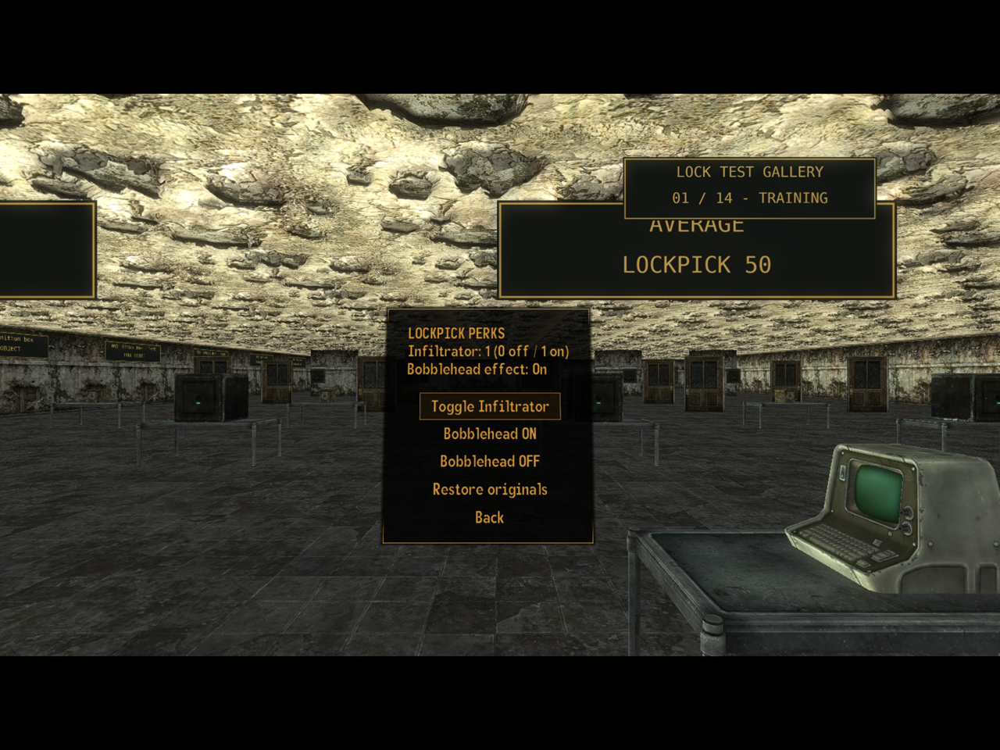

# Private lock-testing stage

Build an additive test plugin from the installed Fallout New Vegas and TTW masters. It creates new cells and references only; it does not edit existing doors, containers, quests or world cells. Use a separate profile and copied saves, with the physical lockpicking addon already configured.

The current catalogue contains **111 distinct model paths, 555 locked objects and 14 galleries**. Each row is one model; columns are Very Easy, Easy, Average, Hard and Very Hard (0/25/50/75/100). The first gallery contains a freestanding safe, ammo box, office door, school door, wall safe, floor safe, footlocker and toolbox. Signs distinguish the four models currently supported as full objects in the physical workspace from standalone-lock fallbacks.

The scan covers pickable locked references in the supplied FalloutNV.esm and Fallout3.esm, plus those eight common models. It excludes key-only locks. This is not a catalogue of every DLC, texture variant or user-added model. Very large objects are reduced to fit a station; their scale and source record are recorded in `stage-catalog.json`. Empty cloned containers have no quest scripts, original loot, ownership or key requirements. Doors have no teleport destination. There are no NPCs or navmesh.



## Terminal

Activate the desk terminal at the entrance of any gallery, using the normal VR activate control. It opens a controller-compatible Fallout menu.

- **Set skill:** 0, 25, 50, 75, 100 or the original value. The stage starts at 100 so every column can be tested. Lower settings retain the native skill requirements.
- **Perks:** toggle Infiltrator, enable/disable the TTW Lockpick Bobblehead effect, or restore their original settings. Changes apply to the next lock attempt.
- **Reset locks:** close and relock the current gallery at its five original difficulty levels.
- **Refill pins:** top up to 200, without removing pins if you already have more.
- Move between galleries or **Return to entry**.

Infiltrator is the native second-attempt perk for locks broken by force-locking. This terminal does not add a force-unlock action to the physical minigame. The installed TTW Thief perk affects sneaking/pickpocketing rather than lockpicking, so it is not included.

The bobblehead button reproduces the verified TTW script effect (`fLockpickBonusHealth = 0.015`; disabled baseline `0.01`). It does not grant or remove the collectible's quest perk. The builder checks the installed TTW script before permitting this effect. Per-game mod-local data preserves the original setting across save loads, because loading a save alone does not reset a changed game setting.

Leaving the stage restores the skill adjustment, original Infiltrator rank and original bobblehead game setting. Loading a normal outside save also clears the temporary game-setting change. Supplied pins and ordinary experience/inventory changes remain in the **test save**; reload your untouched save when finished. Avoid using stage saves for normal play or removing the plugin while saved inside it.

## Build and install

Requires Python with PyFFI 2.2.3, numpy and Pillow, as used by the addon's asset-preparation tools. Supply a readable monospaced TTF with `--font` if DejaVuSansMono is not installed. The generated plugin, scripts and original label assets work under the Windows game and Proton; the generator itself has no Wine dependency.

```sh
python tools/test_stage/build.py \
  --new-vegas '/path/to/Data/FalloutNV.esm' \
  --fallout3 '/path/to/TTW/Fallout3.esm' \
  --output '/path/to/private-mods/Physical Lockpicking Test Stage'
python tools/test_stage/check.py '/path/to/private-mods/Physical Lockpicking Test Stage'
```

Keep `TaleOfTwoWastelands.esm` next to the supplied Fallout3.esm for bobblehead verification. Game meshes and textures must already be available through TTW; the tool does not copy or redistribute them. The generated sign textures and geometry are original. Script support requires xNVSE and JIP LN (already part of the TTW setup).

Enable this new mod and `TTWVRLockStage.esp` in the **private** profile. After loading a copied save, enter via the console:

```text
Call (CompileScript "TTWVRLockStage/Enter.txt")
```

This records the return location before entering. Alternatively set `[Stage] Enter=1` in `Data/config/TTWVRLockStage.ini` before launching; it is consumed once after a save loads. Direct `coc TTWVRLockLab01` works but cannot record the return location; load your original save to leave in that case.

The terminal uses [MessageBoxExAlt callbacks](https://geckwiki.com/index.php/MessageBoxExAlt), and the game-setting restoration uses [mod-local data](https://geckwiki.com/index.php?title=Mod_Local_Data). These avoid stale button polling and game-setting leakage across save loads.

## Local validation

See [the recorded runtime checks](VALIDATION.md). The test stage uses the existing production addon DLL.
